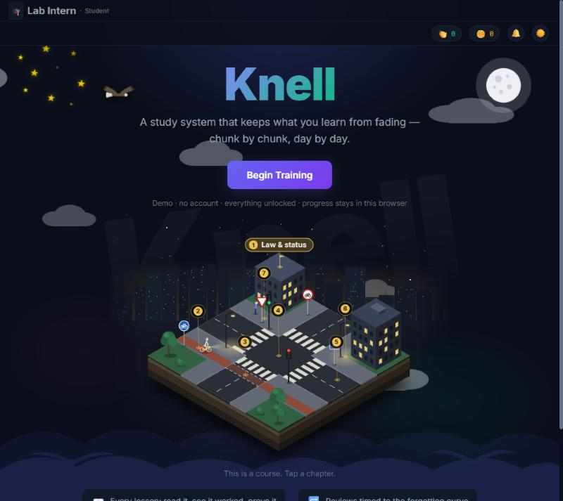
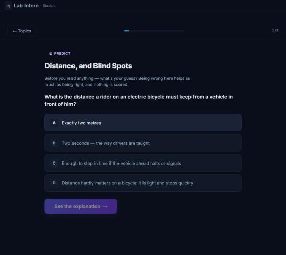

# Knell

**A study app that keeps what you learn from fading.**

Lessons come in small chunks. Passing a topic does not finish it; it
schedules it for spaced review. A garden shows what you still remember.
And a course can be a place: in the e-bike course you pick a chapter and a
small figure runs there through a junction at night, crossing only at the
zebras.

**▶ Live demo: <https://isk1zz.github.io/knell_demo/>** — no account, a
prepared sample profile, progress stays in your browser.

I designed Knell and directed every decision in it. The code was written with
AI assistance (Claude).

<p align="center">
  
  
  
</p>

---

## What is in it

- **Chunked lessons.** Every chunk explains one idea, shows a worked
  example, then asks a question. Two thirds of them (114 of 171) carry about
  200 words and two cited sources; the oldest 57 are still short and
  unsourced, waiting for a rewrite. Most topics open with a guess before you
  read and close with recall in your own words.
- **A mastery gate.** Each topic ends in an exam; 80% enters it into spaced
  review.
- **Spaced review** on SM-2, with one constant changed on evidence (below).
- **The Garden.** Each mastered topic is a plant whose growth stage *is* its
  review interval. A hundred topics passed once is a field of sprouts.
- **Course scenes.** A course drawn as an isometric diorama where every
  chapter stands where it happens.
- **English and Russian** throughout the interface.

Three courses have lessons: *Intro to Computer Science* (48 topics),
*A3 Theory — Electric Bicycle* (7 topics, built on the Israeli Ministry of
Transport's published question bank) and *Philosophy: Cicero* (3 topics).

## Engineering

- **No framework, no build step, no npm dependencies.** About 19,800 lines
  of plain JavaScript, 12,600 of course content and 5,400 of CSS (measured
  2026-11-23). The only
  third-party code is `supabase-js`, the backend's client; the fonts come
  from Google Fonts.
- **Branches you can delete.** A small kernel (events, router, state) and
  feature folders that talk only through it, designed so that removing a
  folder and its `<script>` tags takes the feature out and leaves the rest
  running. See `docs/ARCHITECTURE.md`.
- **A backend that does not believe the client.** 28 migrations, 12 tables,
  37 functions on Postgres (Supabase). Money, XP, reputation and the Forum
  have no client write policy at all: every write goes through a
  `SECURITY DEFINER` function that takes the actor from `auth.uid()`. Found
  and fixed on the way: a time-of-check race in reputation grants (8 of 8
  concurrent grants succeeded; with a lock, the allowed 2), a `UNIQUE`
  constraint Postgres was not enforcing because NULLs count as distinct, and
  a reward endpoint that paid 800 XP in four calls. What the server still
  takes on trust is a learner's own progress row, which they sync and the
  Garden is computed from; that is written down in the migrations as a known
  weakness, and the reputation it can buy is capped at five points a day.
- **A measured fix to spaced repetition.** Textbook SM-2 changes ease by
  exactly zero at the pass mark, so someone who barely passes every review got
  the same intervals as someone perfect: sixth review at 238 days. One
  constant later, 153, while a perfect learner stays at 393. Checked by
  driving the real function, not by algebra.
- **A scene engine in SVG.** Isometric projection, three parallax depth
  layers, a cut-away cross-section computed from the surface, depth-sorted
  sprites, and Dijkstra pathfinding for the runner over a sidewalk-and-zebra
  graph. One engine plus a data recipe per course. Keyboard-operable, honours
  reduced motion, and stops animating off screen.
- **Research that was checked, not trusted.** Three commissioned research
  reports. The first quoted the project's own documentation back as
  findings, so the next two were briefed to look for what is wrong rather
  than to agree. The third one's headline arithmetic reproduced exactly; its
  proposed formula did not do what its own table claimed, and two of its rows
  were wrong. Every decision taken from it is recorded with the case against
  it.

## The demo, honestly

The demo is a separate copy of this app, made by `tools/make-demo.js`. It
changes four things: it switches `Dojo.DEMO` on (`core/demo.js`), blanks the
Supabase address and key, drops the Supabase client script and renames the
cache. With the demo switch on, sign-in is off, a sample profile is loaded,
storage is kept apart from the real app's, and a banner says progress stays in
the browser. The Forum stays closed there, because it needs the server.

This repository is the real app, with sign-in on. Its backend — accounts, sync
across devices, the Forum, reputation, server-paid rewards — is built and was
verified against a live database, but that database is not reachable at the
moment, so the site published from here stops at sign-in. Use the demo link.

**[docs/SHOWCASE.md](docs/SHOWCASE.md)** lists what is in, what is switched
off, what is decided but not built, and what was dropped — where each lives,
how it works and why.

## Run it

Serve the folder over http with any static server:

```bash
git clone https://github.com/Isk1zz/Dojo-Gamify-Learn.git
cd Dojo-Gamify-Learn
npx http-server . -p 8199 -c-1
```

Then open <http://localhost:8199>. The course-scene prototype on its own is
at `/scenes/prototype.html`.

## Where to start reading

| If you want to… | Read |
|---|---|
| understand how it works, in plain words | `docs/HOW-IT-WORKS.md` |
| see what is real and what is not | `docs/SHOWCASE.md` |
| understand how the pieces fit | `docs/ARCHITECTURE.md` |
| know why it is built this way | `PROJECT.md` |
| work on one feature | that folder's `.md` |
| know what is queued | `UPDATESTACK.md` |
| see what changed | `docs/CHANGELOG.md` |
| read the research | `docs/research/` |

## Status and licence

A portfolio snapshot, built from August to November 2026. All rights
reserved: the source is public to read, not licensed for reuse. See `LICENSE`.
